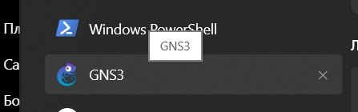
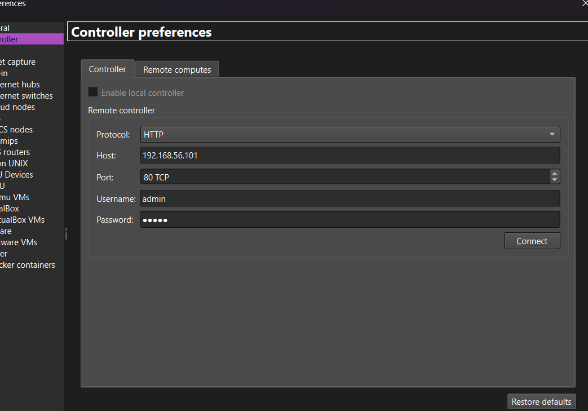
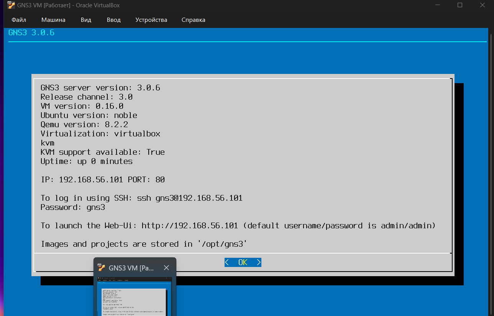
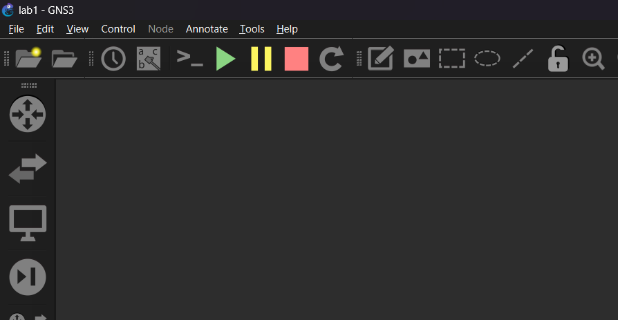
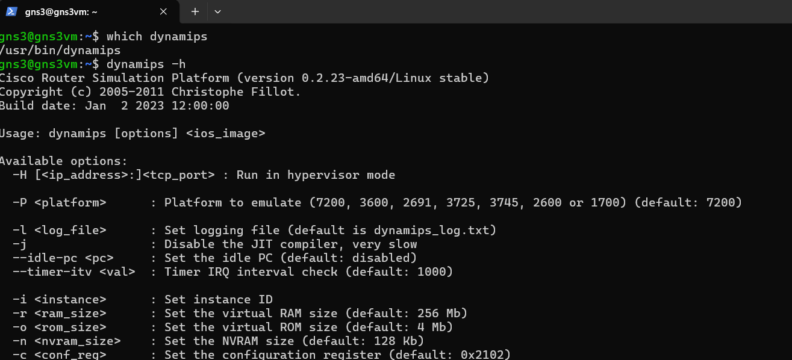
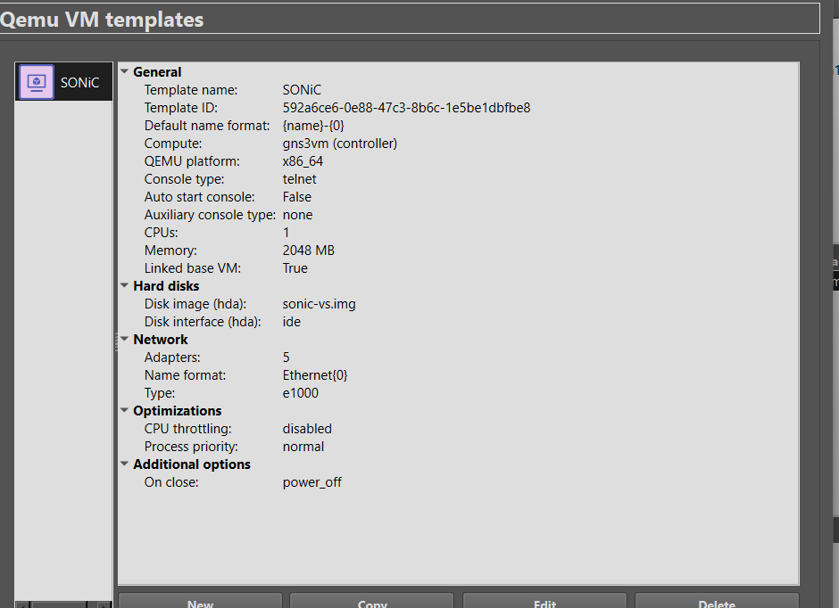
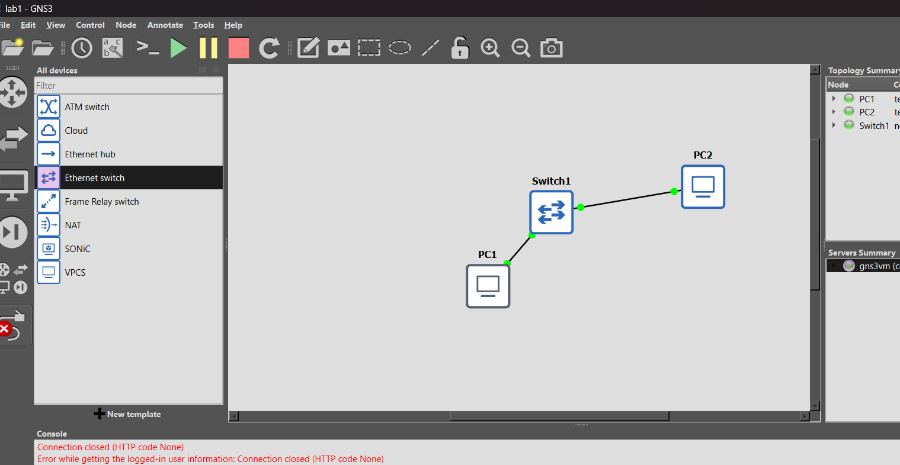
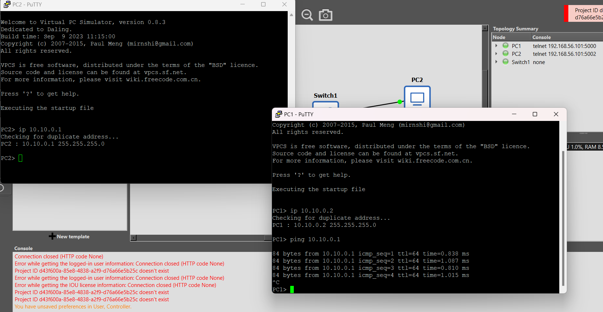

## Установка GNS3 и базовая настройка

## Установка и настройка GNS3

Установка среды выполнена успешно.

GNS3 GUI работает в Windows и подключается к GNS3 VM в VirtualBox. Для настройки GNS3 VM был использован .ova file (Import Appliance)

Успешно создала проект:
Создание нового проекта представлено на рисунке 3:

 В составе GNS3 VM обнаружен QEMU версии 8.2.2, аппаратное ускорение KVM доступно. Компонент Dynamips установлен в составе GNS3 и успешно проходит проверку настроек.

Параметры QEMU Template SONiC представлены на рисунке 5:

## Тестовый проект

В качестве тестового проекта были настроены 2 VPCS и Ethernet switch между ними:

Дали IP 

PC1: `ip 10.10.0.1`
PC2: `ip 10.10.0.1`

и проверяем сеть:

Сеть работает.

Сохраняемся `save`.