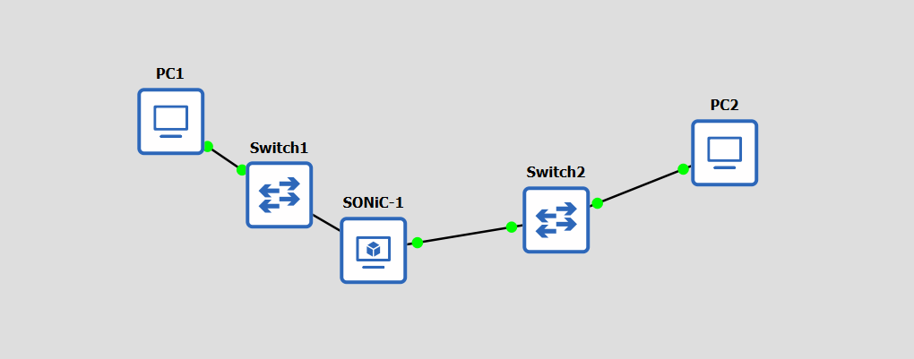
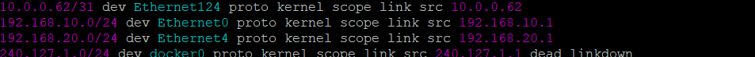
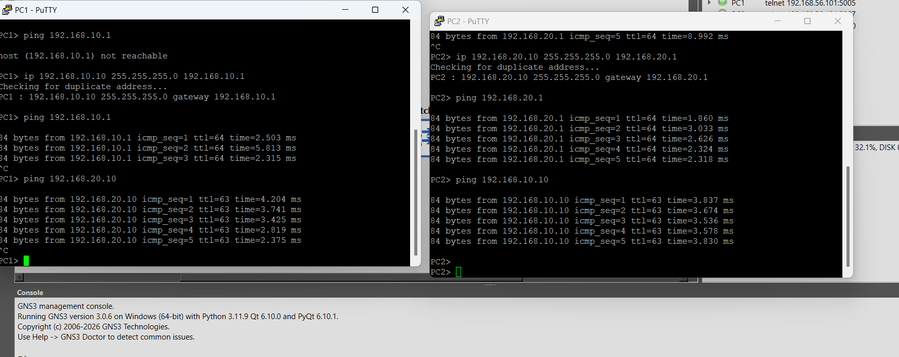

## Настройка маршрутизатора SONiC в GNS3 и построение простой сети

## Создание и настройка топологии

Топология сети:
Устройства были успешно подключены: PC1 — Switch1 — Router (SONiC) — Switch2 — PC2.



### Распределение IP-адресов

**Сегмент 1 (между PC1 и Router):** `192.168.10.0/24`
- PC1: `192.168.10.10/24`, шлюз `192.168.10.1`
- Интерфейс маршрутизатора SONiC (Ethernet0, подключён к Switch1): `192.168.10.1/24`

**Сегмент 2 (между PC2 и Router):** `192.168.20.0/24`
- PC2: `192.168.20.10/24`, шлюз `192.168.20.1`
- Интерфейс маршрутизатора SONiC (Ethernet4, подключён к Switch2): `192.168.20.1/24`

## Конфигурация устройств
 
### Настройка SONiC

Настройка IP-адресов интерфейсов SONiC была выполнена следующими командами:

```bash
sudo config interface ip add Ethernet0 192.168.10.1/24
sudo config interface ip add Ethernet4 192.168.20.1/24
```

Проверка таблицы маршрутизации на SONiC:

`ip route`



### Настройка хостов

Настройка IP-адресов на хостах PC1 и PC2 и проверка связности сети:



Связь между узлами успешно работает: хосты успешно пингуют свои шлюзы на SONiC и друг друга через маршрутизатор.
