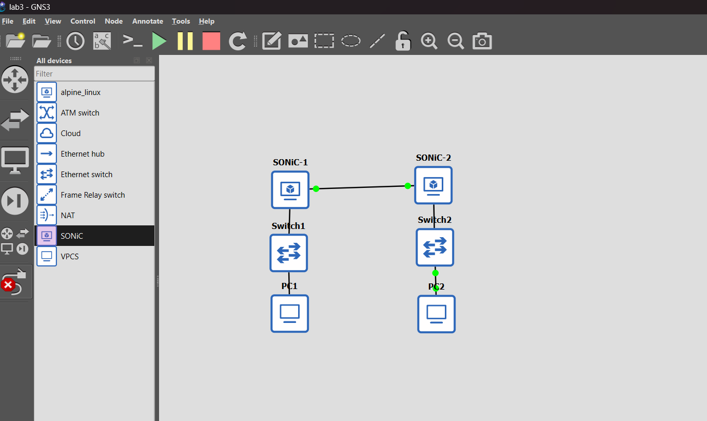
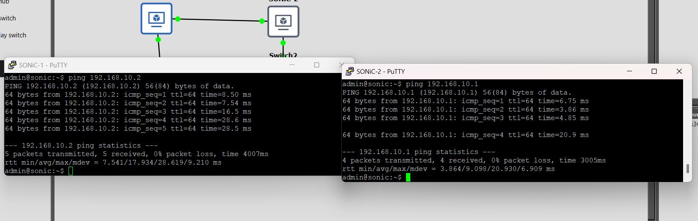
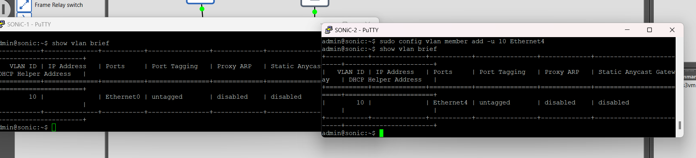
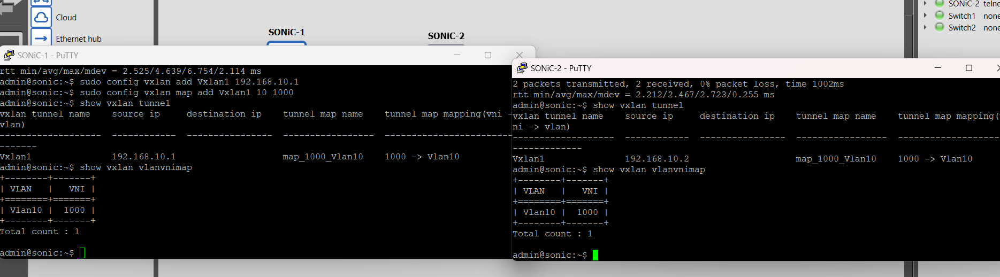
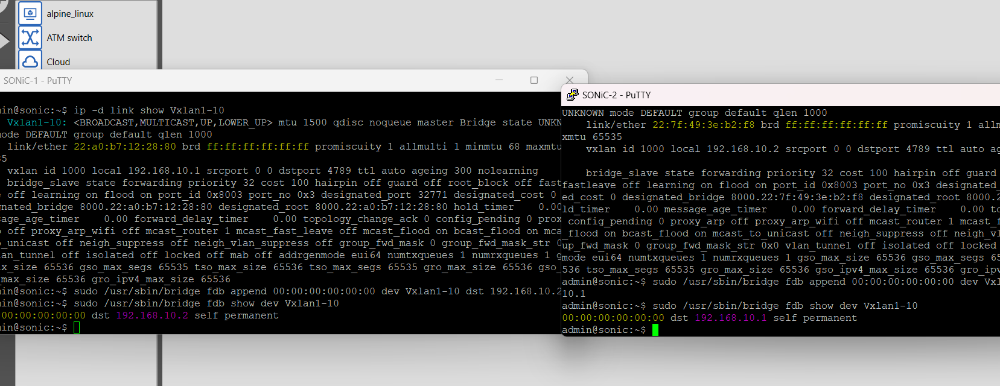
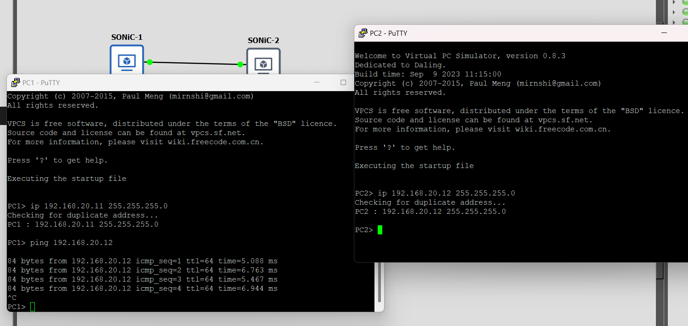
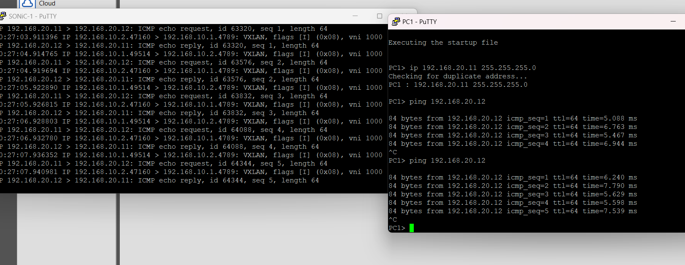

## Настройка VXLAN в GNS3 на базе двух маршрутизаторов SONiC

## Создание и настройка топологии

В GNS3 собрана сеть из двух маршрутизаторов SONiC, двух Ethernet Switch и двух хостов VPCS. Каждый хост подключён через локальный коммутатор к своему SONiC, а маршрутизаторы соединены напрямую.



Рисунок 1 – Топология сети в GNS3

### Распределение IP-адресов

**Underlay (связь между маршрутизаторами):**
- SONiC-1: `192.168.10.1/24`
- SONiC-2: `192.168.10.2/24`

**Overlay (сеть хостов):**
- PC1: `192.168.20.11/24`
- PC2: `192.168.20.12/24`

Перед настройкой underlay с интерфейсов SONiC удалены IP-адреса, заданные по умолчанию.

PC1 и PC2 находятся в одной IP-подсети, поэтому шлюз по умолчанию для проверки L2-связности не задавался. Адреса на межмаршрутизаторных интерфейсах назначены командой `sudo config interface ip add`. Доступность underlay проверена с обоих маршрутизаторов:

```text
# SONiC-1
ping 192.168.10.2

# SONiC-2
ping 192.168.10.1
```



Рисунок 2 – Проверка связи между маршрутизаторами SONiC

## Конфигурация устройств

### Настройка VLAN 10

На обоих маршрутизаторах создана VLAN 10. Порт к локальному коммутатору добавлен как нетегированный: на SONiC-1 это Ethernet0, на SONiC-2 – Ethernet4.

```bash
# SONiC-1
sudo config vlan add 10
sudo config vlan member add -u 10 Ethernet0
show vlan brief

# SONiC-2
sudo config vlan add 10
sudo config vlan member add -u 10 Ethernet4
show vlan brief
```

Параметр `-u` задаёт режим untagged: кадры от VPCS проходят через порт без тега 802.1Q и относятся к VLAN 10. IP-адрес на интерфейс Vlan10 не назначался, так как в работе проверялась связь на канальном уровне, а не маршрутизация между подсетями.



Рисунок 3 – Проверка VLAN 10 на обоих маршрутизаторах

### Настройка VXLAN

На каждом SONiC создан VXLAN-туннель `Vxlan1`. В качестве исходного адреса VTEP использован адрес underlay соответствующего маршрутизатора. VLAN 10 сопоставлена с VNI 1000.

```bash
# SONiC-1
sudo config vxlan add Vxlan1 192.168.10.1
sudo config vxlan map add Vxlan1 10 1000

# SONiC-2
sudo config vxlan add Vxlan1 192.168.10.2
sudo config vxlan map add Vxlan1 10 1000

# Проверка
show vxlan tunnel
show vxlan vlanvnimap
```

VLAN 10 задаёт локальный сегмент Ethernet, а VNI 1000 идентифицирует соответствующий сегмент внутри VXLAN. Полученная конфигурация проверена на обоих SONiC.



Рисунок 4 – Проверка VXLAN-туннелей и соответствия VLAN/VNI

### Настройка FDB

Для передачи широковещательного и неизвестного unicast-трафика к удалённому VTEP добавлена статическая запись FDB. На каждой стороне указан адрес второго маршрутизатора.

```bash
# SONiC-1
sudo /usr/sbin/bridge fdb append 00:00:00:00:00:00 dev Vxlan1-10 dst 192.168.10.2

# SONiC-2
sudo /usr/sbin/bridge fdb append 00:00:00:00:00:00 dev Vxlan1-10 dst 192.168.10.1

# Проверка созданных записей
ip -d link show Vxlan1-10
sudo /usr/sbin/bridge fdb show dev Vxlan1-10
```

Запись с MAC `00:00:00:00:00:00` используется VXLAN-драйвером для отправки flood-трафика удалённому VTEP; это не MAC-адрес хоста. На VXLAN-интерфейсе также проверен режим `nolearning`, при котором удалённые соответствия MAC и VTEP не обучаются автоматически. BGP EVPN в данной работе не настраивался.



Рисунок 5 – Настройка и проверка записей FDB

### Настройка хостов

На VPCS заданы IP-адреса из одной подсети. Затем с PC1 выполнена проверка связи с PC2.

```text
PC1> ip 192.168.20.11 255.255.255.0
PC2> ip 192.168.20.12 255.255.255.0
PC1> ping 192.168.20.12
```



Рисунок 6 – Настройка IP-адресов хостов и проверка ping

## Проверка работоспособности

PC1 получил ответы на запросы `ping 192.168.20.12`, что подтверждает сквозную L2-связность между хостами. Для проверки инкапсуляции на SONiC-1 выполнен захват трафика `tcpdump` с фильтром `udp port 4789`.

В захвате видны внешние IP-адреса VTEP `192.168.10.1` и `192.168.10.2`, VXLAN с VNI 1000 и внутренние ICMP-пакеты между `192.168.20.11` и `192.168.20.12`. Это подтверждает передачу кадров overlay-сети через underlay.



Рисунок 7 – ICMP-трафик внутри VXLAN с VNI 1000

## Заключение

В GNS3 настроена сеть из двух маршрутизаторов SONiC и двух локальных сегментов с хостами VPCS. Между SONiC проверена IP-связность underlay, создана VLAN 10 и настроен VXLAN с VNI 1000. Статические записи FDB направляют flood-трафик к удалённым VTEP. Успешный ping и захват пакетов на UDP-порту 4789 подтвердили передачу ICMP-трафика между хостами через VXLAN. Цель работы достигнута.
