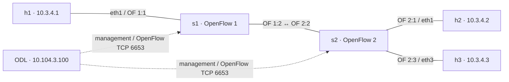

# Лабораторная работа №4 — SDN: OpenFlow 1.3 и OpenDaylight

## Персональные параметры

| Параметр | Значение |
| --- | --- |
| ИСУ | 409303 |
| `STUDENT` | `panina` |
| `N` | `3` |
| Management-сеть | `10.104.3.0/24` |
| ODL | `10.104.3.100` |
| Хосты | h1 `10.3.4.1`, h2 `10.3.4.2`, h3 `10.3.4.3` |
| Префикс потоков | `panina-` |
| Приоритет ACL | `503` |

## Топология и порты



Порты `eth0` — management-сеть Containerlab; OpenFlow-сессии идут через неё. Порты данных — `eth1`–`eth3`. На s1: `eth1` — порт 1 к h1, `eth2` — порт 2 к s2. На s2: `eth1` — порт 1 к h2, `eth2` — порт 2 к s1, `eth3` — порт 3 к h3.

## Файлы

- `lab4.clab.yml` — топология Containerlab.
- `scripts/ovs-setup.sh` — настройка OVS в `OpenFlow13` и `fail-mode=secure`.
- `flows/*.json` — восемь базовых потоков и ACL для ICMP h1 → h3.
- `scripts/push-flows.sh` — отправляет конфигурацию по RESTCONF; по умолчанию применяет все потоки. Режимы `baseline` и `acl` позволяют провести этапы по порядку.
- `scripts/ensure-wsl-links.sh` — восстанавливает data-veths, если после Containerlab deploy в WSL остались только management-интерфейсы.
- `scripts/final-check.sh` — печатает итоговые ping, OpenFlow-сессии, инвентарь и потоки со счётчиками.
- `evidence/final-output.txt` — полный вывод последней успешной финальной проверки.
- `images/` — локальная сборка образов `lab-tools:1.0`, `ovs-lab:latest` и `odl:chromium`. Архив `D:\Downloads\labs.zip` содержит Dockerfile-источники, а не готовые tar-образы; эти сборки дают те же нужные инструменты, OVS userspace и ODL 0.24.0 на Java 21.

## Запуск

Сборку и запуск можно выполнить на Linux-хосте с Docker, Containerlab и доступом к registry/Ubuntu mirror. `images/build-images.sh` соберёт локальные образы `lab-tools:1.0`, `ovs-lab:latest` и `odl:chromium`.

```sh
export STUDENT=panina N=3
cd lab4
./images/build-images.sh
containerlab deploy -t lab4.clab.yml
```

После запуска ODL (обычно около 30 секунд) установите приложения:

```sh
docker exec -t clab-panina-l4-odl /opt/odl/bin/client \
  "feature:install odl-openflowplugin-flow-services-rest odl-openflowplugin-app-table-miss-enforcer odl-restconf-openapi"
```

Подключите OVS к контроллеру:

```sh
docker exec -i -e DPID=1 -e ODL_IP=10.104.3.100 clab-panina-l4-s1 sh < scripts/ovs-setup.sh
docker exec -i -e DPID=2 -e ODL_IP=10.104.3.100 clab-panina-l4-s2 sh < scripts/ovs-setup.sh
```

В этой WSL-среде Containerlab сообщал о создании data links, но после завершения deploy у контейнеров оставался только `eth0`. При выгрузке WSL это может повториться. Если у h1 отсутствует `eth1` или адрес `10.3.4.1`, выполните `./scripts/ensure-wsl-links.sh`, затем повторите `ovs-setup.sh` для s1 и s2. Если после перезапуска OVS базовые потоки не восстановились, выполните `./scripts/push-flows.sh baseline`.

Проверьте отсутствие связности до установки правил, затем установите базовые потоки:

```sh
docker exec clab-panina-l4-h1 ping -c 2 -W 1 10.3.4.2
./scripts/push-flows.sh baseline
docker exec clab-panina-l4-h1 ping -c 3 10.3.4.2
docker exec clab-panina-l4-h1 ping -c 3 10.3.4.3
```

Проведите ACL-эксперимент:

```sh
docker exec -d clab-panina-l4-h3 python3 -m http.server 8080
./scripts/push-flows.sh acl
docker exec clab-panina-l4-h1 ping -c 2 -W 1 10.3.4.3
docker exec clab-panina-l4-h1 curl -s -o /dev/null -w "%{http_code}\n" http://10.3.4.3:8080/
docker exec clab-panina-l4-h1 ping -c 2 10.3.4.2
```

Для финальной проверки, где h1 → h3 должен проходить, удалите ACL, оставив базовые потоки:

```sh
curl -sS -u admin:admin -X DELETE \
  "http://10.104.3.100:8181/rests/data/opendaylight-inventory:nodes/node=openflow%3A1/flow-node-inventory:table=0/flow=panina-acl-icmp-h3" \
  -o /dev/null -w 'DELETE ACL: %{http_code}\n'
docker exec clab-panina-l4-h1 ping -c 2 10.3.4.3
```

Для итогового вывода выполните `mkdir -p evidence && ./scripts/final-check.sh | tee evidence/final-output.txt` из WSL. Скрипт запускает успешный ping перед выводом счётчиков, чтобы в итоговом выводе были видны ненулевые `n_packets`.

## Ответы на вопросы

1. **Почему management-сеть отделена от портов данных?** Это out-of-band управление. Контроллер доступен по отдельной плоскости даже при ошибках в правилах передачи данных; отказ или перегрузка data plane не должны лишать оператора управления.
2. **Что делает table-miss-enforcer?** Устанавливает правило table-miss для пакетов, не совпавших с другими записями, чтобы передать их контроллеру. Само получение packet-in не означает, что контроллер ответит на ARP или построит путь: для этого нужна логика сетевого приложения.
3. **Почему начальный ping не проходит?** Без совпавшего правила OVS не передаёт кадр на соседний data-порт. Table-miss отправляет его контроллеру, но без L2-приложения контроллер не реализует пересылку/ответ.
4. **Config и operational в ODL.** Config хранит желаемые записи, отправленные через RESTCONF; operational отражает состояние, полученное от OpenFlow-коммутатора. В опыте `ovs-ofctl del-flows br0 in_port=1` удалил `panina-s1-1to2` из OVS и operational, но запись осталась в config. Повторный RESTCONF PUT вернул правило на коммутатор.
5. **Отказ контроллера и reconciliation.** При отключённом контроллере в `secure` OVS сохранил правила, `is_connected` стал `false`, и pings h1 → h2 и h1 → h3 прошли 3/3. В `standalone` после 30 секунд таблица s2 опустела, а h2 → h3 прошёл 3/3 через обычную L2-коммутацию. После возврата `secure` и ODL обе сессии подключились, базовые потоки вернулись из config в OVS, ping h1 → h3 прошёл 2/2. Значит, в этом опыте reconciliation восстановил желаемые потоки при повторном подключении.

## Результаты выполнения

| Проверка | Результат |
| --- | --- |
| Containerlab | 6 контейнеров в `running`; management-сеть `10.104.3.0/24` |
| ODL / OpenFlow | Инвентарь `openflow:1`, `openflow:2`; обе сессии `is_connected: true`; OpenFlow 1.3 |
| До потоков | h1 → h2: 0/2 ответов |
| Базовые потоки | h1 → h2: 3/3; h1 → h3: 3/3 |
| ACL | h1 → h3 ICMP: 0/2; HTTP: 200; счётчик ACL: 2 пакета / 196 байт; после DELETE ping 2/2 |
| Отказ, `secure` | Контроллер отключён, h1 → h2 и h1 → h3: по 3/3 |
| Отказ, `standalone` | Таблица s2 пуста; h2 → h3: 3/3 |
| Возврат | `is_connected: true`; базовые потоки восстановились; h1 → h3: 2/2 |

OpenDaylight описывает `table-miss-enforcer` как приложение, добавляющее default flow к controller ([документация OpenFlow Plugin](https://docs.opendaylight.org/projects/openflowplugin/en/stable-calcium/users/installation.html)). Open vSwitch описывает `standalone` как переход к обычной MAC-learning коммутации при потере контроллера, в отличие от `secure` ([документация fail-mode](https://docs.openvswitch.org/en/latest/topics/porting/)).
