## Лабораторная работа №4 — SDN: OpenFlow 1.3, Open vSwitch и OpenDaylight

**Студент:** Панина Анна Сергеевна  
**Группа:** K3423  
**ИСУ:** 409303  
**Дата выполнения:** 13.11.2026  
**Репозиторий:** [network_functions_virtualization](https://github.com/paninanq/network_functions_virtualization)

## Цель работы

Развернуть OpenDaylight и два коммутатора Open vSwitch, подключить их по OpenFlow 1.3, настроить проактивную пересылку, проверить ACL и изучить поведение сети при отказе контроллера в режимах <code>secure</code> и <code>standalone</code>.

## Персональные параметры

| Параметр | Значение |
| --- | --- |
| ИСУ | 409303 |
| <code>STUDENT</code> | <code>panina</code> |
| <code>N</code> | 3 |
| Management-подсеть | <code>10.104.3.0/24</code> |
| Адрес ODL | <code>10.104.3.100</code> |
| Подсеть хостов | <code>10.3.4.0/24</code> |
| Префикс потоков | <code>panina-</code> |
| Приоритет ACL | 503 |

## Топология и адресация

Плоскость управления вынесена в management-сеть Containerlab. Контроллер ODL подключается к OVS через <code>eth0</code>; пользовательский трафик проходит по портам данных <code>eth1</code>–<code>eth3</code>. Это out-of-band-управление: доступ к контроллеру сохраняется при проблемах в сети передачи данных.

~~~mermaid
flowchart LR
  h1["h1 · 10.3.4.1"] ---|"eth1 / OF 1:1"| s1["s1 · OpenFlow 1"]
  s1 ---|"OF 1:2 ↔ OF 2:2"| s2["s2 · OpenFlow 2"]
  s2 ---|"OF 2:1 / eth1"| h2["h2 · 10.3.4.2"]
  s2 ---|"OF 2:3 / eth3"| h3["h3 · 10.3.4.3"]
  odl["ODL · 10.104.3.100"] -. "management / OpenFlow TCP 6653" .-> s1
  odl -. "management / OpenFlow TCP 6653" .-> s2
~~~

| Узел | Management IP | Интерфейс данных |
| --- | --- | --- |
| ODL | <code>10.104.3.100</code> | OpenFlow TCP <code>6653</code>, RESTCONF <code>8181</code> |
| s1 | <code>10.104.3.11</code> | <code>eth1</code> ↔ h1, <code>eth2</code> ↔ s2 |
| s2 | <code>10.104.3.12</code> | <code>eth1</code> ↔ h2, <code>eth2</code> ↔ s1, <code>eth3</code> ↔ h3 |
| h1 | <code>10.104.3.2</code> | <code>eth1</code>, <code>10.3.4.1/24</code> |
| h2 | <code>10.104.3.3</code> | <code>eth1</code>, <code>10.3.4.2/24</code> |
| h3 | <code>10.104.3.4</code> | <code>eth1</code>, <code>10.3.4.3/24</code> |

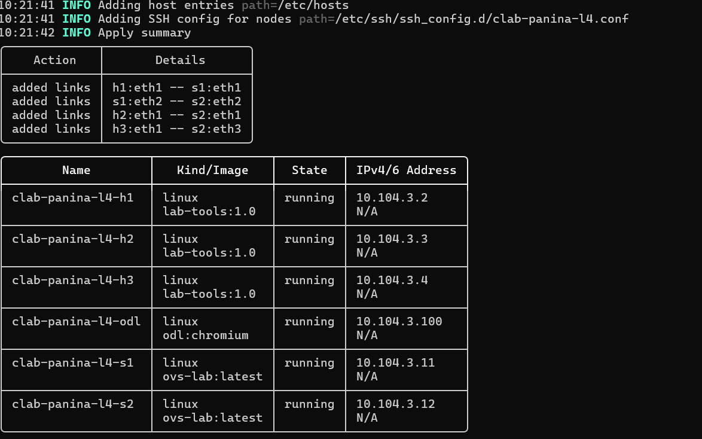

Рисунок 1 – Созданные связи и запущенные узлы Containerlab.

## Развёртывание OpenDaylight и подключение OVS

В контейнере ODL установлены приложения <code>odl-openflowplugin-flow-services-rest</code>, <code>odl-openflowplugin-app-table-miss-enforcer</code> и <code>odl-restconf-openapi</code>. Затем на s1 и s2 настроены мосты <code>br0</code>, протокол OpenFlow 1.3 и <code>fail-mode=secure</code>. Контроллер доступен через management-сеть по TCP-порту 6653; RESTCONF работает на порту 8181.

Рисунок 2 – Установка модулей OpenDaylight через Karaf.

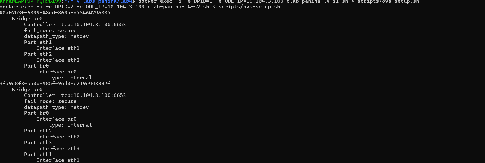

Рисунок 3 – Настройка <code>br0</code>, портов данных и соединения с контроллером.

В инвентаре ODL обнаружены узлы <code>openflow:1</code> и <code>openflow:2</code>. Сессии OpenFlow установлены, а в таблице каждого коммутатора присутствовало правило table-miss с действием <code>CONTROLLER</code>.

## Проверка связности и проактивные потоки

Перед проверкой подтверждён маршрут через data-plane: <code>10.3.4.2 dev eth1 src 10.3.4.1</code>. После удаления базовых потоков на коммутаторах оставалось только table-miss, а в режиме <code>secure</code> кадры не пересылались между портами данных. Ping h1 → h2 завершился без ответов: 3 пакета отправлено, 0 получено.

~~~sh
docker exec clab-panina-l4-h1 ip route get 10.3.4.2
docker exec clab-panina-l4-h1 ping -c 3 -W 1 10.3.4.2
~~~

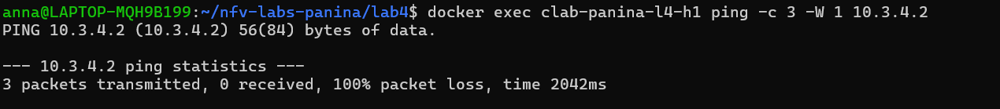

Рисунок 4 – Ping до установки правил OpenFlow: потери 100%.

Для восстановления связности через RESTCONF установлены восемь базовых потоков с приоритетом 200. На s1 потоки передают кадры между портами 1 и 2. На s2 трафик к h2 и h3 направляется по IPv4-адресу назначения; отдельные правила обрабатывают ARP.

| Поток | Коммутатор | Условие и действие |
| --- | --- | --- |
| <code>panina-s1-1to2</code>, <code>panina-s1-2to1</code> | s1 | Порт 1 → 2 и порт 2 → 1 |
| <code>panina-s2-1to2</code>, <code>panina-s2-3to2</code> | s2 | Порт 1 → 2 и порт 3 → 2 |
| <code>panina-s2-to-h2-ip</code>, <code>panina-s2-to-h2-arp</code> | s2 | Из порта 2, адрес назначения h2 → порт 1 |
| <code>panina-s2-to-h3-ip</code>, <code>panina-s2-to-h3-arp</code> | s2 | Из порта 2, адрес назначения h3 → порт 3 |

~~~sh
./scripts/push-flows.sh baseline
docker exec clab-panina-l4-h1 ping -c 3 10.3.4.2
docker exec clab-panina-l4-h1 ping -c 3 10.3.4.3
~~~

Скрипт получил HTTP 201 для каждого потока. После установки правил ping h1 → h2 и h1 → h3 проходил успешно, по 3 ответа из 3.

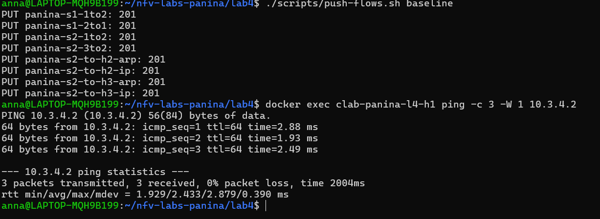

Рисунок 5 – Установка базовых правил и успешная проверка h1 → h2.

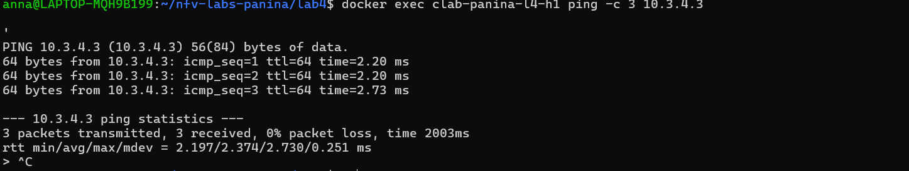

Рисунок 6 – Успешная проверка h1 → h3 при установленных базовых потоках.

Для проверки состава правил выполнен вывод таблиц OpenFlow обоих коммутаторов. На s1 также виден активный ACL с приоритетом 503; на s2 — правила ARP и IPv4 для адресов h2 и h3.

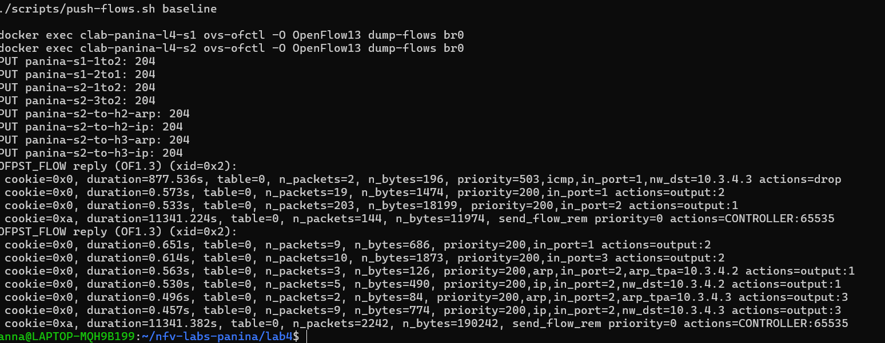

Рисунок 7 – Потоки OpenFlow и счётчики на обоих коммутаторах.

## ACL и статистика потока

На s1 установлен поток <code>panina-acl-icmp-h3</code> с приоритетом 503. Он совпадает с IPv4-пакетами ICMP, поступающими из порта 1 и направленными к <code>10.3.4.3</code>, после чего отбрасывает их. Более низкоприоритетные базовые потоки продолжают пересылать другой трафик.

~~~sh
./scripts/push-flows.sh acl
docker exec clab-panina-l4-h1 ping -c 2 -W 1 10.3.4.3
docker exec clab-panina-l4-h1 curl -s -o /dev/null -w "%{http_code}\n" http://10.3.4.3:8080/
docker exec clab-panina-l4-h1 ping -c 2 10.3.4.2
~~~

Во время проверки ping h1 → h3 не проходил, HTTP-запрос к серверу h3 на порту 8080 возвращал код 200, а ping h1 → h2 оставался успешным. На первом выводе счётчик ACL составил 2 пакета и 196 байт. После двух дополнительных ping счётчик вырос до 4 пакетов и 392 байт: RESTCONF PUT вернул 204 и сохранил уже существующее правило со статистикой. После удаления ACL через RESTCONF получен HTTP 204, и ping h1 → h3 снова проходил.

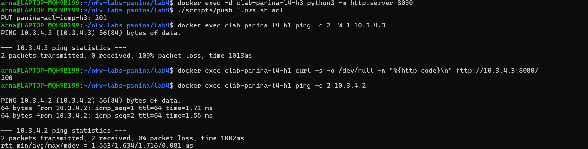

Рисунок 8 – ACL блокирует ICMP к h3, пропускает HTTP, связь с h2 сохраняется.

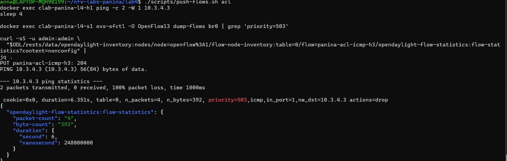

Рисунок 9 – Счётчик ACL после дополнительных ICMP-запросов: 4 пакета и 392 байта.

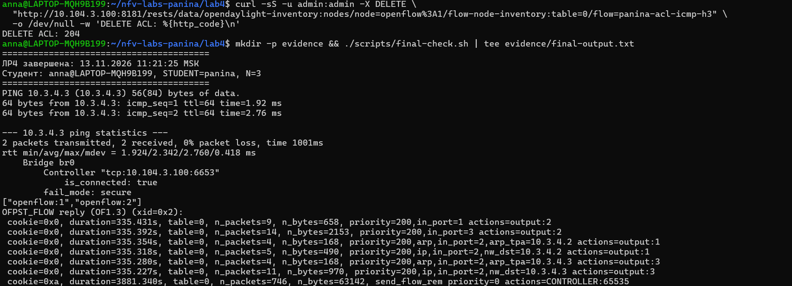

Рисунок 10 – Удаление ACL и итоговое состояние OVS: контроллер подключён, базовые счётчики ненулевые.

## Отказ контроллера и восстановление

| Состояние | Наблюдение |
| --- | --- |
| ODL остановлен, <code>fail-mode=secure</code> | <code>is_connected=false</code>; ранее установленные потоки остались в OVS, ping h1 → h2 прошёл 3/3. ACL с приоритетом 503 оставался активным для h1 → h3. |
| ODL остановлен, <code>fail-mode=standalone</code> | После ожидания таблица s2 очистилась; OVS перешёл к обычному обучению MAC-адресов, ping h2 → h3 прошёл. |
| ODL возвращён, <code>fail-mode=secure</code> | Обе сессии подключились. ODL восстановил базовые потоки и сохранённый ACL; h1 → h3 остался заблокирован правилом ACL, ping 0/2. После удаления ACL ping h1 → h3 проходит. |

Режим <code>secure</code> безопаснее: OVS пересылает трафик только по явно установленным правилам. <code>standalone</code> повышает доступность локальной коммутации во время отказа контроллера, но разрешает обычное обучение MAC-адресов. В режиме <code>standalone</code> таблица s2 стала пустой, после чего h2 → h3 прошёл 3/3.

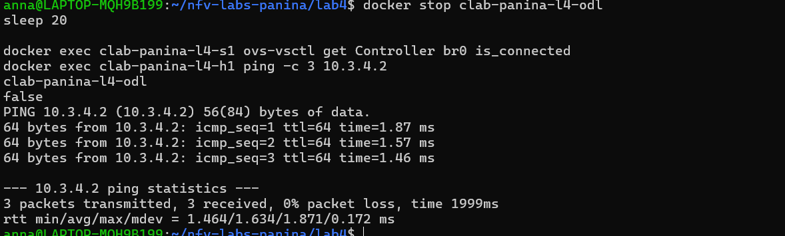

Рисунок 11 – Контроллер отключён, но ранее установленные потоки пропускают h1 → h2.

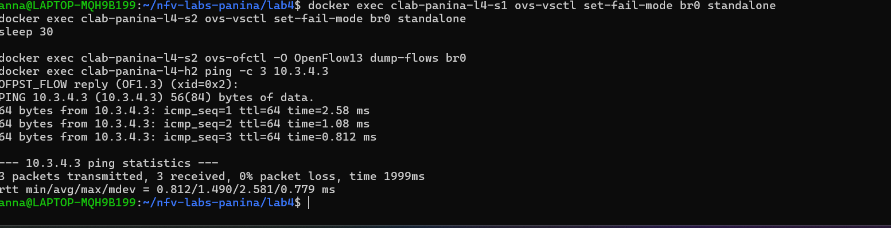

Рисунок 12 – Таблица потоков s2 пуста; локальный ping h2 → h3 проходит.

После возврата ODL обе сессии показали <code>is_connected=true</code>. Ping h1 → h3 в этом снимке не прошёл, потому что ACL оставался в конфигурации контроллера и был восстановлен вместе с базовыми потоками. Это подтверждено правилом <code>priority=503</code> в таблице s1; после удаления ACL связь h1 → h3 возвращается. Следовательно, reconciliation восстановил не только базовую пересылку, но и ACL.

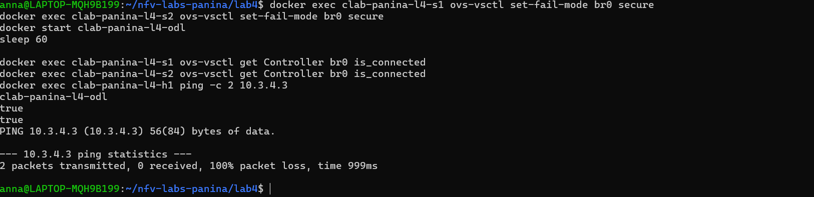

Рисунок 13 – Контроллер подключён; восстановленный ACL продолжает блокировать ICMP к h3.

## Ответы на контрольные вопросы

1. **Почему управление вынесено в отдельную сеть?** Это out-of-band-управление. Оно отделяет управляющий трафик от пользовательского и позволяет сохранить доступ к контроллеру при отказе или ошибочной настройке data-plane.
2. **Что делает table-miss-enforcer?** Устанавливает правило для пакетов, не совпавших с другими потоками, и отправляет их контроллеру. Само правило не выполняет L2-коммутацию и не гарантирует ответ на ARP; для этого нужна логика соответствующего приложения.
3. **Почему ping не проходит без потоков?** В режиме <code>secure</code> OVS не пересылает пакет на соседний порт без подходящего правила. Table-miss отправляет пакет контроллеру, но установленное приложение не строит путь и не отвечает на ARP.
4. **Чем отличаются config и operational в ODL?** Config хранит желаемые записи, отправленные через RESTCONF. Operational отражает состояние, сообщённое коммутатором, включая статистику. Удаление потока непосредственно командой <code>ovs-ofctl</code> меняет operational-состояние, но запись может остаться в config; повторная синхронизация способна установить её снова.
5. **Как ведёт себя сеть при отказе контроллера?** В <code>secure</code> ранее установленные потоки продолжают работать. В <code>standalone</code> OVS использует обычную L2-коммутацию. После возврата ODL базовые правила и ACL восстановились из config. Поэтому h1 → h3 оставался заблокирован до удаления ACL. <code>secure</code> лучше контролирует пересылку, <code>standalone</code> даёт большую автономность.

## Заключение

Развёрнуты два коммутатора Open vSwitch и контроллер OpenDaylight, настроен OpenFlow 1.3 и установлены проактивные правила. Проверено отсутствие связности до установки потоков и успешная передача данных после их установки. ACL избирательно блокировал ICMP к h3, сохраняя HTTP и трафик к h2. Также проверены режимы <code>secure</code> и <code>standalone</code>, восстановление соединения с контроллером и reconciliation потоков.

Исходные файлы топологии, скриптов и JSON-потоков находятся в каталоге <code>lab4/</code> репозитория [network_functions_virtualization](https://github.com/paninanq/network_functions_virtualization).

## Приложение А. JSON-файлы потоков

Ниже приведены все восемь базовых потоков и ACL, использованные в работе.

### flows/s1-1to2.json

~~~json
{
  "flow-node-inventory:flow": [
    {
      "id": "panina-s1-1to2",
      "table_id": 0,
      "priority": 200,
      "match": {
        "in-port": "openflow:1:1"
      },
      "instructions": {
        "instruction": [
          {
            "order": 0,
            "apply-actions": {
              "action": [
                {
                  "order": 0,
                  "output-action": {
                    "output-node-connector": "2"
                  }
                }
              ]
            }
          }
        ]
      }
    }
  ]
}

~~~

### flows/s1-2to1.json

~~~json
{
  "flow-node-inventory:flow": [
    {
      "id": "panina-s1-2to1",
      "table_id": 0,
      "priority": 200,
      "match": {
        "in-port": "openflow:1:2"
      },
      "instructions": {
        "instruction": [
          {
            "order": 0,
            "apply-actions": {
              "action": [
                {
                  "order": 0,
                  "output-action": {
                    "output-node-connector": "1"
                  }
                }
              ]
            }
          }
        ]
      }
    }
  ]
}

~~~

### flows/s2-1to2.json

~~~json
{
  "flow-node-inventory:flow": [
    {
      "id": "panina-s2-1to2",
      "table_id": 0,
      "priority": 200,
      "match": {
        "in-port": "openflow:2:1"
      },
      "instructions": {
        "instruction": [
          {
            "order": 0,
            "apply-actions": {
              "action": [
                {
                  "order": 0,
                  "output-action": {
                    "output-node-connector": "2"
                  }
                }
              ]
            }
          }
        ]
      }
    }
  ]
}

~~~

### flows/s2-3to2.json

~~~json
{
  "flow-node-inventory:flow": [
    {
      "id": "panina-s2-3to2",
      "table_id": 0,
      "priority": 200,
      "match": {
        "in-port": "openflow:2:3"
      },
      "instructions": {
        "instruction": [
          {
            "order": 0,
            "apply-actions": {
              "action": [
                {
                  "order": 0,
                  "output-action": {
                    "output-node-connector": "2"
                  }
                }
              ]
            }
          }
        ]
      }
    }
  ]
}

~~~

### flows/s2-to-h2-arp.json

~~~json
{
  "flow-node-inventory:flow": [
    {
      "id": "panina-s2-to-h2-arp",
      "table_id": 0,
      "priority": 200,
      "match": {
        "in-port": "openflow:2:2",
        "ethernet-match": {
          "ethernet-type": {
            "type": 2054
          }
        },
        "arp-target-transport-address": "10.3.4.2/32"
      },
      "instructions": {
        "instruction": [
          {
            "order": 0,
            "apply-actions": {
              "action": [
                {
                  "order": 0,
                  "output-action": {
                    "output-node-connector": "1"
                  }
                }
              ]
            }
          }
        ]
      }
    }
  ]
}

~~~

### flows/s2-to-h2-ip.json

~~~json
{
  "flow-node-inventory:flow": [
    {
      "id": "panina-s2-to-h2-ip",
      "table_id": 0,
      "priority": 200,
      "match": {
        "in-port": "openflow:2:2",
        "ethernet-match": {
          "ethernet-type": {
            "type": 2048
          }
        },
        "ipv4-destination": "10.3.4.2/32"
      },
      "instructions": {
        "instruction": [
          {
            "order": 0,
            "apply-actions": {
              "action": [
                {
                  "order": 0,
                  "output-action": {
                    "output-node-connector": "1"
                  }
                }
              ]
            }
          }
        ]
      }
    }
  ]
}

~~~

### flows/s2-to-h3-arp.json

~~~json
{
  "flow-node-inventory:flow": [
    {
      "id": "panina-s2-to-h3-arp",
      "table_id": 0,
      "priority": 200,
      "match": {
        "in-port": "openflow:2:2",
        "ethernet-match": {
          "ethernet-type": {
            "type": 2054
          }
        },
        "arp-target-transport-address": "10.3.4.3/32"
      },
      "instructions": {
        "instruction": [
          {
            "order": 0,
            "apply-actions": {
              "action": [
                {
                  "order": 0,
                  "output-action": {
                    "output-node-connector": "3"
                  }
                }
              ]
            }
          }
        ]
      }
    }
  ]
}

~~~

### flows/s2-to-h3-ip.json

~~~json
{
  "flow-node-inventory:flow": [
    {
      "id": "panina-s2-to-h3-ip",
      "table_id": 0,
      "priority": 200,
      "match": {
        "in-port": "openflow:2:2",
        "ethernet-match": {
          "ethernet-type": {
            "type": 2048
          }
        },
        "ipv4-destination": "10.3.4.3/32"
      },
      "instructions": {
        "instruction": [
          {
            "order": 0,
            "apply-actions": {
              "action": [
                {
                  "order": 0,
                  "output-action": {
                    "output-node-connector": "3"
                  }
                }
              ]
            }
          }
        ]
      }
    }
  ]
}

~~~

### flows/acl-icmp-h3.json

~~~json
{
  "flow-node-inventory:flow": [
    {
      "id": "panina-acl-icmp-h3",
      "table_id": 0,
      "priority": 503,
      "match": {
        "in-port": "openflow:1:1",
        "ethernet-match": {
          "ethernet-type": {
            "type": 2048
          }
        },
        "ip-match": {
          "ip-protocol": 1
        },
        "ipv4-destination": "10.3.4.3/32"
      },
      "instructions": {
        "instruction": [
          {
            "order": 0,
            "apply-actions": {
              "action": [
                {
                  "order": 0,
                  "drop-action": {}
                }
              ]
            }
          }
        ]
      }
    }
  ]
}

~~~
