# Лабораторная работа № 5 — MikroTik CHR как vCPE

**Студент:** Панина Анна Сергеевна  
**Группа:** K3423  
**ИСУ:** 409303  
**STUDENT:** `panina`  
**Дата выполнения:** 19–20 ноября 2026 года  
**Репозиторий:** [network_functions_virtualization](https://github.com/paninanq/network_functions_virtualization)

## Цель работы

В работе я развернула виртуальную корпоративную сеть на Containerlab и настроила MikroTik CHR в роли виртуального пограничного маршрутизатора головного офиса. Проверила обмен маршрутами между RouterOS и FRR в SONiC, доступ сервера наружу через NAT, фильтрацию входящего трафика, связь с филиалом через WireGuard и управление маршрутизатором через REST API.

## Персональные параметры

Мой номер ИСУ — 409303. Последние две цифры дают значение `N = 3`, поэтому я использовала персональные адреса, номера AS и порт WireGuard из таблицы.

| Параметр | Значение |
| --- | --- |
| ИСУ / STUDENT / N | 409303 / `panina` / 3 |
| Сеть ЦОД | `10.3.100.0/24`; шлюз dc1 `10.3.100.1`; сервер srv1 `10.3.100.10` |
| Линк dc1–HQ | `10.3.1.0/30`; dc1 `.1`, HQ `.2` |
| Сеть филиала | `10.3.200.0/24`; шлюз BR `.1`, станция pcb `.10` |
| WAN HQ | `100.64.1.0/30`; ISP `.1`, HQ `.2` |
| WAN BR | `100.64.2.0/30`; ISP `.1`, BR `.2` |
| WireGuard | `10.3.254.0/30`; HQ `.1`, BR `.2`; UDP `13003` |
| AS dc1 / HQ | `65003` / `65103` |
| Management Containerlab | `10.105.3.0/24` |

## Топология

ЦОД построен на SONiC `dc1` и сервере `srv1`. На границе ЦОД находится HQ, который обменивается маршрутами с FRR по eBGP и выполняет функции vCPE. Сегменты ISP соединяют HQ с BR; за BR находится сеть филиала. Между HQ и BR поверх внешней сети ISP работает WireGuard.

~~~mermaid
flowchart LR
  srv1["srv1 · 10.3.100.10"] --- dc1["dc1 · SONiC/FRR\nAS 65003"]
  dc1 ---|"eBGP · 10.3.1.0/30"| hq["hq-panina · CHR\nAS 65103"]
  hq ---|"100.64.1.0/30"| isp["ISP · Linux\n198.51.100.1"]
  isp ---|"100.64.2.0/30"| br["br-panina · CHR"]
  br --- pcb["pcb · 10.3.200.10"]
  hq -. "WireGuard · 10.3.254.0/30\nUDP 13003" .- br
~~~

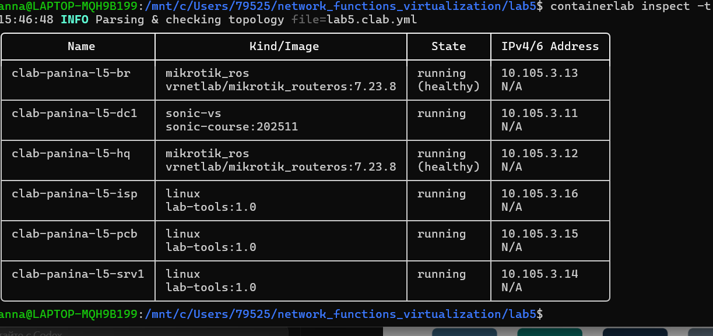

Рисунок 1 – Все шесть узлов Containerlab запущены; оба экземпляра CHR имеют состояние `healthy`.

Для RouterOS используется образ CHR 7.23.8. Оба маршрутизатора показывают уровень лицензии Free. SONiC/FRR работает отдельным Linux-контейнером.

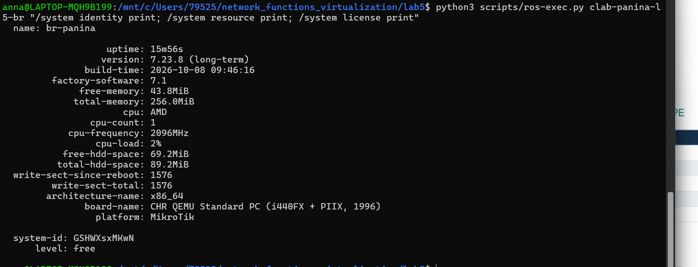

Рисунок 2 – Версия RouterOS и уровень лицензии филиального CHR.

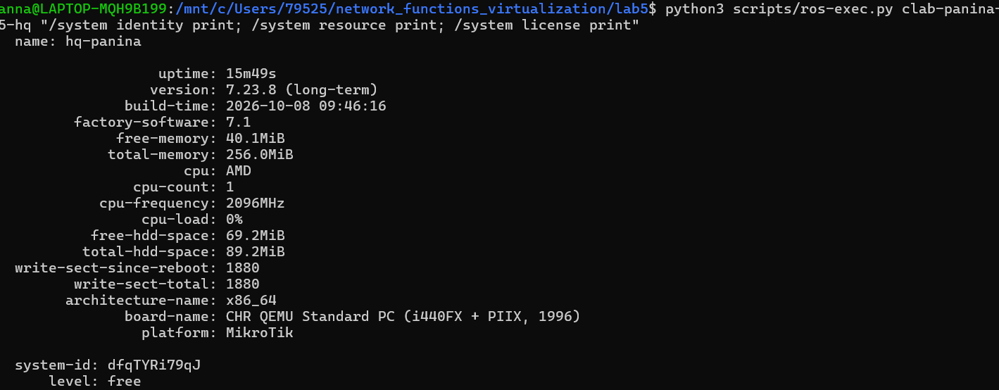

Рисунок 3 – Версия RouterOS и уровень лицензии CHR головного офиса.

## Адресация и запуск

Management-адреса узлов Containerlab находятся в отдельной сети `10.105.3.0/24`. В RouterOS порт `ether1` используется для управления, а интерфейсы данных начинаются с `ether2`. Сервер и станция филиала подключены через `eth1`.

| Узел | Management IP | Интерфейсы данных |
| --- | --- | --- |
| `dc1` | `10.105.3.11` | Ethernet0 `10.3.100.1/24`; Ethernet4 `10.3.1.1/30` |
| `hq` | `10.105.3.12` | ether2 `10.3.1.2/30`; ether3 `100.64.1.2/30`; wg-br `10.3.254.1/30` |
| `br` | `10.105.3.13` | ether2 `100.64.2.2/30`; ether3 `10.3.200.1/24`; wg-hq `10.3.254.2/30` |
| `srv1` | `10.105.3.14` | eth1 `10.3.100.10/24`, шлюз `10.3.100.1` |
| `pcb` | `10.105.3.15` | eth1 `10.3.200.10/24`, шлюз `10.3.200.1` |
| `isp` | `10.105.3.16` | eth1 `100.64.1.1/30`; eth2 `100.64.2.1/30`; lo `198.51.100.1/32` |

## eBGP между SONiC/FRR и RouterOS

На `dc1` я включила FRR с AS `65003` и router-id `10.3.1.1`. HQ использует AS `65103` и устанавливает eBGP-соседство с `10.3.1.1`. Перед проверкой я убрала management default route из таблицы Linux на `dc1`: иначе маршрут через management-интерфейс мешал использовать BGP-маршрут по умолчанию.

На HQ сессия с адресом `10.3.1.1` перешла в состояние `Established`. На dc1 сосед `10.3.1.2` также находится в состоянии `Established`; получены два префикса. В таблице маршрутизации SONiC установлены `0.0.0.0/0` и `10.3.200.0/24` через HQ и Ethernet4.

~~~sh
python3 scripts/ros-exec.py clab-panina-l5-hq "/routing/bgp/session print"
docker exec clab-panina-l5-dc1 vtysh -c "show bgp summary"
docker exec clab-panina-l5-dc1 vtysh -c "show ip route bgp"
~~~

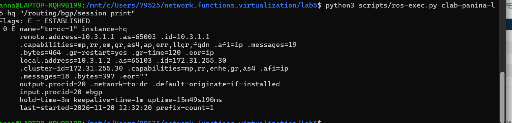

Рисунок 4 – RouterOS показывает установленную сессию HQ с dc1, удалённая AS — 65003.

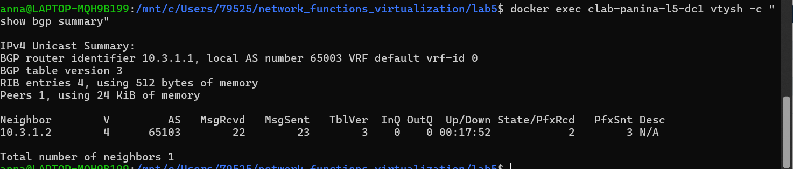

Рисунок 5 – Сводка FRR: сосед `10.3.1.2` в AS 65103, приняты два префикса.

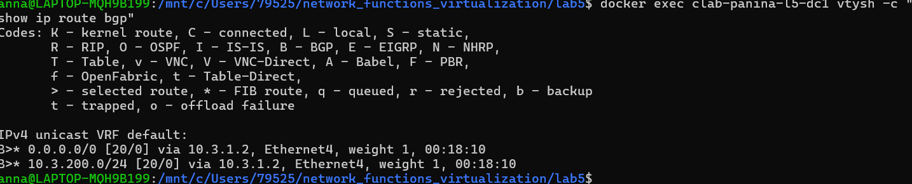

Рисунок 6 – В таблицу dc1 установлены default route и сеть филиала через `10.3.1.2`.

В HQ включён `output.default-originate=if-installed`. Такой режим позволяет объявлять default только при наличии установленного маршрута выхода. Также HQ объявляет сеть филиала из списка `to-dc`.

## NAT и межсетевой экран

На HQ настроен masquerade для трафика из ЦОД, выходящего через WAN-интерфейс `ether3`. Я проверила HTTP-доступ сервера к сервису ISP `198.51.100.1`. Запрос завершился кодом 200, а в журнале ISP источником указан адрес `100.64.1.2` — адрес HQ после source NAT. На BR также настроен masquerade для выхода филиала.

~~~sh
docker exec clab-panina-l5-srv1 curl -sS -o /dev/null -w "HTTP %{http_code}\\n" http://198.51.100.1/
docker logs --tail 10 clab-panina-l5-isp
~~~

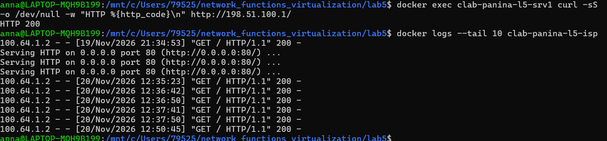

Рисунок 7 – HTTP-запрос завершился кодом 200; ISP зарегистрировал адрес источника `100.64.1.2`.

На HQ я настроила фильтрацию по принципу «разрешено только явно заданное». В цепочке `input` разрешены установленные соединения, ICMP, управление через `ether1`, BGP на TCP/179 и WireGuard на UDP/13003; новые входящие подключения с WAN и остальные запросы к маршрутизатору блокируются. В цепочке `forward` разрешены ответный трафик, выход ЦОД в Интернет и обмен между ЦОД и филиалом через туннель. Остальной транзит попадает в `forward-default-deny`.

Проба с ISP к серверу `10.3.100.10` завершилась без ответов: отправлено два ICMP-запроса, получено ноль. В сохранённом снимке `hq-final.txt` у `forward-default-deny` — 4 пакета и 336 байт; это накопительный счётчик за интервал проверок, а не результат только двух пакетов этой пробы.

~~~sh
docker exec clab-panina-l5-isp ping -c 2 -W 1 10.3.100.10
python3 scripts/ros-exec.py clab-panina-l5-hq "/ip firewall filter print stats"
~~~

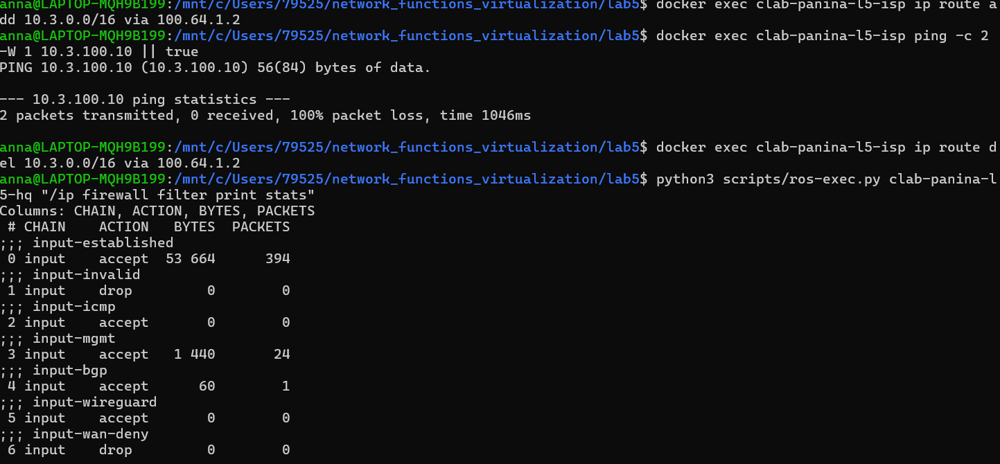

Рисунок 8 – Из ISP нет ответа от защищённого сервера; показаны правила и счётчики firewall HQ.

## WireGuard между офисами

На HQ создан интерфейс `wg-br` с адресом `10.3.254.1/30`, а на BR — `wg-hq` с адресом `10.3.254.2/30`. Внешние endpoints используют адреса `100.64.1.2` и `100.64.2.2`, UDP-порт `13003` и keepalive 25 секунд. В `allowed-address` включены адреса peer и удалённые сети. Маршрут к `10.3.200.0/24` на HQ проходит через туннель; BR направляет сеть ЦОД туда же.

Проверка с `pcb` к `srv1` прошла: получено 3 ответа из 3. В выводе peers на обоих CHR зафиксированы актуальные handshake и ненулевые RX/TX.

~~~sh
python3 scripts/ros-exec.py clab-panina-l5-hq "/interface wireguard peers print detail"
python3 scripts/ros-exec.py clab-panina-l5-br "/interface wireguard peers print detail"
docker exec clab-panina-l5-pcb ping -c 3 -W 2 10.3.100.10
~~~

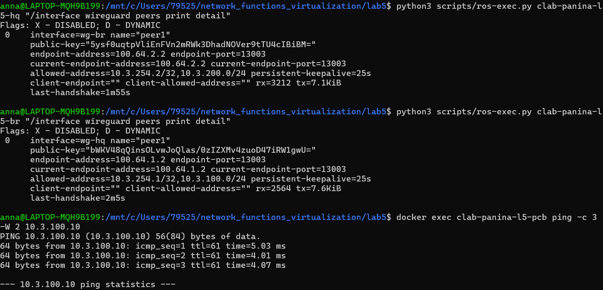

Рисунок 9 – WireGuard peers имеют актуальный handshake; ping от филиальной станции к серверу прошёл 3/3.

На внешних интерфейсах ISP виден UDP-трафик между `100.64.1.2:13003` и `100.64.2.2:13003`. Внутренние адреса `10.3.x.x` в этом внешнем захвате не отображаются: они передаются внутри зашифрованного WireGuard-туннеля.

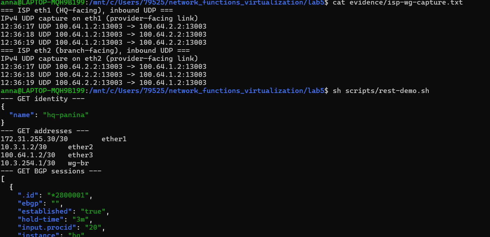

Рисунок 10 – На ISP зафиксированы только внешние UDP-endpoints туннеля; рядом показано чтение состояния HQ через REST.

## Управление RouterOS через REST API

С REST API я прочитала identity, адреса интерфейсов и состояние BGP-сессии HQ. Затем проверила операции над временной записью address-list: `PUT` создал запись `192.0.2.3`, `PATCH` изменил её комментарий, а `DELETE` удалил запись и вернул HTTP 204. Временная запись после демонстрации не оставлена.

~~~sh
sh scripts/rest-demo.sh
~~~

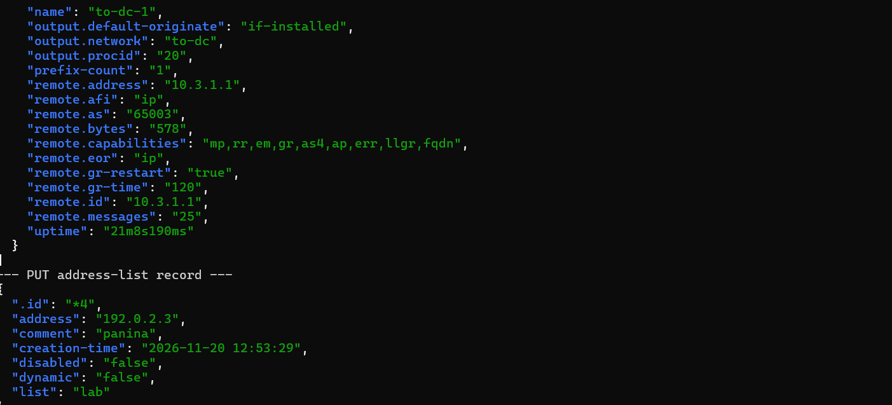

Рисунок 11 – REST GET вернул данные identity и BGP-сессии; PUT создал временную запись address-list.

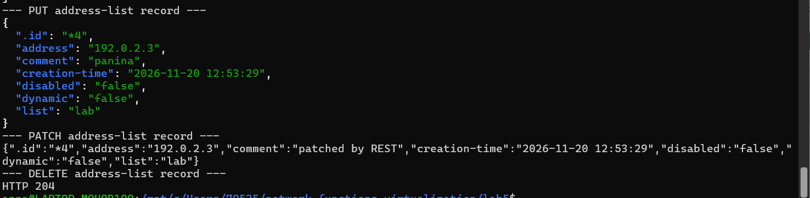

Рисунок 12 – PATCH изменил комментарий, DELETE завершился кодом HTTP 204.

## Ответы на контрольные вопросы

1. **Почему CHR требует аппаратной виртуализации, а SONiC-VS — нет? Чем ограничена Free-лицензия?** В этой сборке CHR запускает полноценную RouterOS VM через QEMU в оболочке vrnetlab, поэтому аппаратная виртуализация нужна для нормальной работы и ускорения VM. SONiC-VS работает как Linux-контейнер и использует ядро хоста. Free-лицензия CHR не имеет ограничения по сроку, но ограничивает исходящую скорость интерфейса до 1 Мбит/с; измерение скорости поэтому не показывает пределы сервера или туннеля.
2. **Почему management default route мешает маршруту, полученному по BGP?** Маршрут ядра через management-интерфейс остаётся активным и имеет преимущество перед BGP default в FIB. После удаления `default dev eth0` FRR устанавливает BGP-маршрут через `10.3.1.2` как используемый маршрут по умолчанию.
3. **Почему `if-installed` надёжнее `always`?** При `if-installed` HQ анонсирует default только при наличии установленного маршрута выхода. `always` может продолжать объявлять доступность Интернета после потери реального upstream-маршрута.
4. **Почему ответы на соединение srv1 проходят без отдельного правила WAN → ЦОД?** Соединение инициирует сервер изнутри. Connection tracking распознаёт ответные пакеты как `established,related` и пропускает их. Новые соединения с WAN не имеют такого состояния и блокируются финальным правилом `forward-default-deny`.
5. **Какие адреса видит ISP при передаче WireGuard?** Провайдер видит внешние адреса `100.64.1.2` и `100.64.2.2`, UDP-порт 13003, время и объём пакетов. Адреса `10.3.x.x` находятся внутри зашифрованного туннеля и в захвате внешнего интерфейса не видны.
6. **Почему приватный ключ не попадает в обычный экспорт и как хранить секреты?** RouterOS скрывает чувствительные параметры при обычном экспорте. Опция `show-sensitive` раскрывает их и без необходимости её использовать не следует. Приватные ключи и пароли хранят вне Git в защищённом хранилище; в репозитории оставляют конфигурации без секретов.

## Заключение

Я собрала мультивендорную сеть из SONiC/FRR, двух MikroTik CHR и Linux-узлов. Между dc1 и HQ поднялась eBGP-сессия, а SONiC установил default route и маршрут к филиальной сети. HTTP-проверка подтвердила source NAT на HQ. Политика firewall пропустила разрешённый трафик и заблокировала WAN-пробу к серверу ЦОД. WireGuard связал офис и филиал, что подтвердилось успешным ping и захватом внешнего UDP-трафика. Через REST API я прочитала состояние RouterOS и выполнила PUT, PATCH и DELETE. Поставленная цель достигнута.

В `configs/` находятся экспорты HQ, BR и FRR, а также скрипт настройки dc1. В обычных экспортах нет приватных ключей WireGuard и паролей. Каталог `lab5/` создан в локальном checkout; отправка этих файлов в `origin` не подтверждена.

## Основные результаты

| Проверка | Результат |
| --- | --- |
| Containerlab | 6 узлов `running`; оба MikroTik CHR `healthy` |
| eBGP | `Established`; dc1 получил два префикса от HQ |
| BGP-маршруты | `0.0.0.0/0` и `10.3.200.0/24` через `10.3.1.2` |
| NAT | HTTP 200; ISP видит источник `100.64.1.2` |
| WAN-фильтрация | Ping к серверу ЦОД: 0 ответов из 2; счётчик deny — накопительный |
| WireGuard | Свежий handshake, ненулевой RX/TX; ping филиал → ЦОД 3/3 |
| REST API | GET/PUT/PATCH/DELETE; DELETE — HTTP 204 |

## Источники

1. Методические указания к лабораторной работе № 5 «Мультивендорная корпоративная сеть: MikroTik CHR как vCPE». 2026.
2. [MikroTik CHR](https://help.mikrotik.com/docs/spaces/ROS/pages/18350234/Cloud+Hosted+Router+CHR).
3. [Containerlab: MikroTik RouterOS](https://containerlab.dev/manual/kinds/vr-ros/).
4. [MikroTik: BGP](https://help.mikrotik.com/docs/spaces/ROS/pages/328220/BGP).
5. [MikroTik: NAT](https://help.mikrotik.com/docs/spaces/ROS/pages/3211299/NAT).
6. [MikroTik: Filter](https://help.mikrotik.com/docs/spaces/ROS/pages/48660608/Filter).
7. [MikroTik: WireGuard](https://help.mikrotik.com/docs/spaces/ROS/pages/69664792/WireGuard).
8. [MikroTik: REST API](https://help.mikrotik.com/docs/spaces/ROS/pages/47579162/REST+API).

## Приложение А. Конфигурационные файлы

Ниже приведены сохранённые конфигурации HQ, BR и FRR. В них остаются публичные ключи WireGuard, но нет приватных ключей и паролей. Полные версии также лежат в каталоге `configs/`.

### A.1 `configs/hq.rsc`

~~~routeros
# 2026-11-20 12:36:36 by RouterOS 7.23.8
# system id = dfqTYRi79qJ
#
/interface ethernet set [ find default-name=ether1 ] disable-running-check=no
/interface ethernet set [ find default-name=ether2 ] disable-running-check=no
/interface ethernet set [ find default-name=ether3 ] disable-running-check=no
/interface wireguard add listen-port=13003 mtu=1420 name=wg-br
/routing bgp instance add as=65103 name=hq
/interface wireguard peers add allowed-address=10.3.254.2/32,10.3.200.0/24 endpoint-address=100.64.2.2 endpoint-port=13003 interface=wg-br name=peer1 persistent-keepalive=25s public-key="5ysf0uqtpVliEnFVn2mRWk3DhadNOVer9tTU4cIBiBM="
/ip address add address=172.31.255.30/30 interface=ether1 network=172.31.255.28
/ip address add address=10.3.1.2/30 comment=to-dc interface=ether2 network=10.3.1.0
/ip address add address=100.64.1.2/30 comment=wan interface=ether3 network=100.64.1.0
/ip address add address=10.3.254.1/30 comment=wg-hq interface=wg-br network=10.3.254.0
/ip dhcp-client add interface=ether1 name=client1
/ip firewall address-list add address=10.3.200.0/24 comment=branch-prefix list=to-dc
/ip firewall filter add action=accept chain=input comment=input-established connection-state=established,related
/ip firewall filter add action=drop chain=input comment=input-invalid connection-state=invalid
/ip firewall filter add action=accept chain=input comment=input-icmp protocol=icmp
/ip firewall filter add action=accept chain=input comment=input-mgmt in-interface=ether1
/ip firewall filter add action=accept chain=input comment=input-bgp dst-port=179 in-interface=ether2 protocol=tcp
/ip firewall filter add action=accept chain=input comment=input-wireguard dst-port=13003 protocol=udp
/ip firewall filter add action=drop chain=input comment=input-wan-deny in-interface=ether3
/ip firewall filter add action=drop chain=input comment=input-default-deny
/ip firewall filter add action=accept chain=forward comment=forward-established connection-state=established,related
/ip firewall filter add action=drop chain=forward comment=forward-invalid connection-state=invalid
/ip firewall filter add action=accept chain=forward comment=dc-to-internet in-interface=ether2 out-interface=ether3
/ip firewall filter add action=accept chain=forward comment=branch-to-dc in-interface=wg-br out-interface=ether2
/ip firewall filter add action=accept chain=forward comment=dc-to-branch in-interface=ether2 out-interface=wg-br
/ip firewall filter add action=drop chain=forward comment=forward-default-deny
/ip firewall nat add action=masquerade chain=srcnat comment=inside-to-internet out-interface=ether3
/ip route add comment=clab-mgmt dst-address=10.105.3.0/24 gateway=172.31.255.29
/ip route add comment=isp dst-address=0.0.0.0/0 gateway=100.64.1.1
/ip route add comment=branch-through-wg dst-address=10.3.200.0/24 gateway=wg-br
/routing bgp connection add instance=hq local.role=ebgp name=to-dc output.default-originate=if-installed .network=to-dc remote.address=10.3.1.1 .as=65003
/system identity set name=hq-panina
~~~

### A.2 `configs/br.rsc`

~~~routeros
# 2026-11-20 12:36:38 by RouterOS 7.23.8
# system id = GSHWXsxMKwN
#
/interface ethernet set [ find default-name=ether1 ] disable-running-check=no
/interface ethernet set [ find default-name=ether2 ] disable-running-check=no
/interface ethernet set [ find default-name=ether3 ] disable-running-check=no
/interface wireguard add listen-port=13003 mtu=1420 name=wg-hq
/interface wireguard peers add allowed-address=10.3.254.1/32,10.3.100.0/24 endpoint-address=100.64.1.2 endpoint-port=13003 interface=wg-hq name=peer1 persistent-keepalive=25s public-key="bWKV48qQinsOLvwJoQlas/0zIZXMv4zuoD47iRW1gwU="
/ip address add address=172.31.255.30/30 interface=ether1 network=172.31.255.28
/ip address add address=100.64.2.2/30 comment=wan interface=ether2 network=100.64.2.0
/ip address add address=10.3.200.1/24 comment=branch-lan interface=ether3 network=10.3.200.0
/ip address add address=10.3.254.2/30 comment=wg-branch interface=wg-hq network=10.3.254.0
/ip dhcp-client add interface=ether1 name=client1
/ip firewall nat add action=masquerade chain=srcnat comment=branch-to-internet out-interface=ether2
/ip route add comment=clab-mgmt dst-address=10.105.3.0/24 gateway=172.31.255.29
/ip route add comment=isp dst-address=0.0.0.0/0 gateway=100.64.2.1
/ip route add comment=dc-through-wg dst-address=10.3.100.0/24 gateway=wg-hq
/system identity set name=br-panina
~~~

### A.3 `configs/dc1-frr.conf`

~~~text
Building configuration...
Current configuration:
!
frr version 10.4.1
frr defaults traditional
hostname dc1
domainname localdomain
zebra nexthop-group keep 1
fpm address 127.0.0.1
no fpm use-next-hop-groups
service integrated-vtysh-config
!
router bgp 65003
 bgp router-id 10.3.1.1
 no bgp ebgp-requires-policy
 neighbor 10.3.1.2 remote-as 65103
 !
 address-family ipv4 unicast
  network 10.3.100.0/24
 exit-address-family
exit
!
ip nht resolve-via-default
!
ipv6 nht resolve-via-default
!
end
~~~

### A.4 `configs/dc1.sh`

~~~sh
#!/bin/sh
set -eu

DC1=${DC1:-clab-panina-l5-dc1}

docker exec "$DC1" supervisorctl start zebra mgmtd staticd bgpd >/dev/null 2>&1 || true
docker exec "$DC1" config interface startup Ethernet0
docker exec "$DC1" config interface startup Ethernet4
docker exec "$DC1" config interface ip add Ethernet0 10.3.100.1/24 || true
docker exec "$DC1" config interface ip add Ethernet4 10.3.1.1/30 || true
docker exec "$DC1" ip route del default dev eth0 >/dev/null 2>&1 || true

docker exec "$DC1" vtysh -c "configure terminal" \
  -c "router bgp 65003" \
  -c "bgp router-id 10.3.1.1" \
  -c "no bgp ebgp-requires-policy" \
  -c "neighbor 10.3.1.2 remote-as 65103" \
  -c "address-family ipv4 unicast" \
  -c "network 10.3.100.0/24" \
  -c "exit-address-family" \
  -c "end" \
  -c "write memory"

echo "dc1 addressing and FRR BGP configured"
~~~

## Приложение Б. Финальная проверка

В репозитории сохранён [текстовый вывод финальной проверки](evidence/final-output.txt): он показывает установленную BGP-сессию, маршруты на dc1, успешный ping из филиала и HTTP 200. Это именно сохранённый текстовый вывод, не отдельный скриншот терминала. Скриншоты, относящиеся к этим проверкам, приведены в разделах выше. Файлы лабораторной пока находятся в локальном checkout; их публикация в `origin` не подтверждена.

~~~text
HQ identity: hq-panina
BGP session: Established, HQ AS 65103 ↔ dc1 AS 65003
dc1 BGP routes: 0.0.0.0/0 and 10.3.200.0/24 via 10.3.1.2
PCB → SRV1 ping: 2 packets transmitted, 2 received, 0% packet loss
DC → ISP HTTP: 200
~~~
